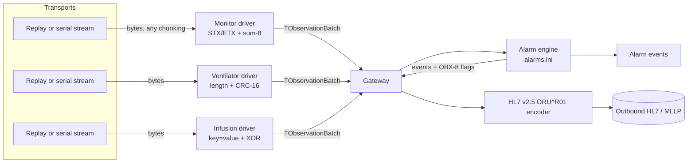

# bedside-link

Device connectivity gateway for intensive-care equipment: pluggable drivers for bedside monitors, ventilators and infusion pumps, frame parsing, normalisation to HL7 v2 observation messages, and alarm evaluation.


> Not a medical device. For engineering demonstration only. All device protocols, streams and values in this repository are invented and synthetic.

See also: [telemetry-orb](https://github.com/pgallo/telemetry-orb), the real-time distribution side of the same story (a CORBA hub that fans bedside vitals out to central monitoring stations).

## What it demonstrates

- A driver abstraction in Object Pascal: an abstract `TDeviceDriver` push parser, a class-reference registry (`class of TDeviceDriver`) so channels are built from configuration, and three drivers that each speak a different invented wire protocol.
- Three framing styles and their failure modes: STX/ETX ASCII frames with a sum-8 checksum (monitor), binary length-prefixed frames with CRC-16/CCITT (ventilator), and line-oriented key=value records with an XOR checksum (infusion pump).
- Byte-at-a-time state machines that resynchronise after noise, truncated frames, corrupted length bytes and oversize lines, with per-device counters for checksum, framing and content errors plus sequence-gap detection.
- A transport layer over `TStream`, so a serial port handle or socket stream can replace the replay transport, which fragments recorded streams into random-sized reads to exercise partial-frame handling.
- A normalised observation model (bed, device, parameter code, value, UCUM unit, timestamp, quality) and an HL7 v2.5 ORU^R01 encoder with correct delimiter escaping and quality mapped to OBX-11.
- An alarm engine configured from an INI file: high/low thresholds with hysteresis, rate of change per minute, onset filtering, latching with acknowledgement, and high/medium/low priority per condition.

## Architecture



Each channel pairs one transport with one driver. The gateway polls channels round-robin with a small read buffer, so a chatty device cannot starve a quiet one. Drivers never see the transport: they receive bytes through `Feed` and emit one `TObservationBatch` per accepted frame. The gateway evaluates alarms on each batch before encoding it, so the HL7 message for a sample carries the abnormal flags that sample caused. Units: `devicedriver`, `drvmonitor`, `drvventilator`, `drvinfusion`, `transport`, `obsmodel`, `checksums`, `alarmengine`, `hl7encoder`, `gateway`.

## Quickstart

Requires Free Pascal 3.2.2 (`apt-get install fpc`) and `make`. The test suite uses FPCUnit and its console runner, which ship with the compiler.

```sh
make demo                      # build build/bedsidelink
make run                       # replay data/*.bin through the gateway
build/bedsidelink --hl7 all    # print every HL7 message instead of one per device
make test                      # FPCUnit suite + demo smoke test
make check-samples             # regenerate the recorded streams and compare with data/
```

Abridged demo output:

```
08:31:40 BED01  MON-0107  #10  HR=119 SPO2=87 RR=16 TEMP=37.3
  ALARM RAISED  BED01  SPO2  high   low  value=87.0 limit=90.0
08:33:07 BED02  PMP-0420  #6   INF_STATE=OCCLUDED INF_RATE=0.0 ... INF_OCCL=1 ...
  ALARM RAISED  BED02  INF_OCCL high   high value=1.0 limit=0.5
...
Parser statistics
  MON-0107  bytes=2197 ok=33 control=0 crc_err=1 framing_err=2 ... seq_gaps=3 lost=3 discarded=270
  VEN-0311  bytes=1428 ok=33 control=7 crc_err=2 framing_err=2 ... seq_gaps=3 lost=3 discarded=119
Alarms still displayed
  BED01  PIP      high high   latched
  BED01  SPO2     low  high   latched
  BED02  INF_OCCL high high   latched
```

A generated message, with the pump's free-text label escaped:

```
MSH|^~\&|BEDSIDELINK|ICU-LAB|OBS-SINK|LAB|20261020090000||ORU^R01^ORU_R01|BED00000003|T|2.5|||NE|NE
PID|1||V249D72^^^BEDSIDELINK^VN||UNIDENTIFIED^BED02
PV1|1|I|ICU1^^BED02
OBR|1|PMP-0420-0||DEVOBS^Device observations^L|||20261020083007|||||||||||||||20261020083007||INFUSION|F
OBX|2|NM|INF_RATE^Infusion rate^L||12.5|mL/h^mL/h^UCUM|||||F|||20261020083007||||PMP-0420
OBX|6|ST|INF_DRUG^Infusion label^L||Heparin 25000 U \T\ NaCl 0.9%\S\50 mL||||||F|||20261020083007||||PMP-0420
```

## Design decisions

1. **Drivers are push parsers fed by the gateway.**
   Decision: a driver exposes `Feed(bytes)` and an `OnBatch` event; it never reads from a port itself.
   Why: framing bugs live at chunk boundaries. With a push interface the same driver runs over a serial port, a terminal server or a replay, and the tests can feed every chunk size from 1 to 17 bytes and assert identical results.
   Trade-off: the driver has to keep explicit parse state between calls instead of writing a simple blocking "read until ETX" loop.

2. **The binary parser rescans after a CRC failure instead of skipping the claimed length.**
   Decision: on a bad CRC the ventilator driver drops one byte and looks for the next sync pattern.
   Why: a single corrupted LEN byte can claim up to 255 bytes. Skipping that many would silently discard the valid frames behind it. A test injects exactly that and checks that the following frames survive.
   Trade-off: worst case O(n²) work over a long burst of garbage that keeps matching the sync bytes, bounded here by the 72-byte maximum payload.

3. **Quality travels with every value.**
   Decision: each observation carries valid, questionable or invalid. It maps to OBX-11 (F, R, X), invalid values are sent empty, and the alarm engine ignores invalid samples and keeps questionable ones out of the rate history.
   Why: a probe-off reading of 0 % SpO2 is not a desaturation, and a motion artefact produces a slope steep enough to fire any rate alarm. Downstream systems need to know which numbers were not trustworthy.
   Trade-off: every consumer has to handle three states instead of assuming every number is real.

4. **Alarm clear thresholds are offset from trigger thresholds, and latching is explicit.**
   Decision: each condition is a small state machine (inactive, active, latched) with hysteresis, optional onset count and acknowledgement.
   Why: a heart rate hovering around its limit should raise one alarm, not one per sample. Alarm fatigue is a real clinical safety problem. Latching keeps a transient high-priority event visible until someone has seen it.
   Trade-off: a value that recovers slowly keeps its alarm active longer, and hysteresis widths need per-parameter tuning.

5. **Escaping is a single pass per character, and numbers are always formatted with an invariant decimal separator.**
   Decision: `HL7Escape` maps each delimiter in one loop; numeric output uses a dedicated `TFormatSettings`.
   Why: chained string replacements double-escape (`|` becomes `\F\`, then the backslashes are escaped again). A gateway running on a host with a comma decimal locale would otherwise emit `7,50`, which a receiver parses as two components. Both are tested.
   Trade-off: the encoder assumes the default `|^~\&` delimiters rather than reading them from configuration.

6. **Sample streams are generated, not hand-edited.**
   Decision: `tools/gensamples.pas` builds the recorded streams with the drivers' own encoders and injects named faults; `make check-samples` verifies the committed files match.
   Why: binary fixtures edited by hand drift from the protocol. Generated fixtures document exactly which fault sits where, and the end-to-end test asserts the exact error counts.
   Trade-off: the encoders and parsers share code paths, so a symmetric misunderstanding of a protocol would not be caught. The parser unit tests use hand-built byte sequences for the edge cases to compensate.

## Scope and limits

- No real device protocols. The three protocols are invented to show three framing styles; real equipment uses vendor or standard protocols with session setup, polling and association handling that are out of scope.
- No serial port, MLLP listener or outbound TCP connection. The transport abstraction is in place, but only the replay transport is implemented.
- No patient identity. The gateway knows beds and devices; PID carries a synthetic visit-scoped identifier. Admission, discharge and transfer handling belong to a downstream system.
- No local parameter-to-standard-nomenclature mapping table. OBX-3 uses local codes with the `L` coding system.
- Single-threaded polling loop. A production gateway would use one reader thread per port with a queue toward the encoder.
- Alarm logic is illustrative and not validated against any alarm standard.

## About this lab

A compact reference implementation written in 2026. It reconstructs, on synthetic data, patterns I have used in production systems (device stream parsing, normalisation to HL7 v2 and alarm evaluation for intensive-care monitoring), without reproducing any proprietary design.

## License

MIT. See [LICENSE](LICENSE).
